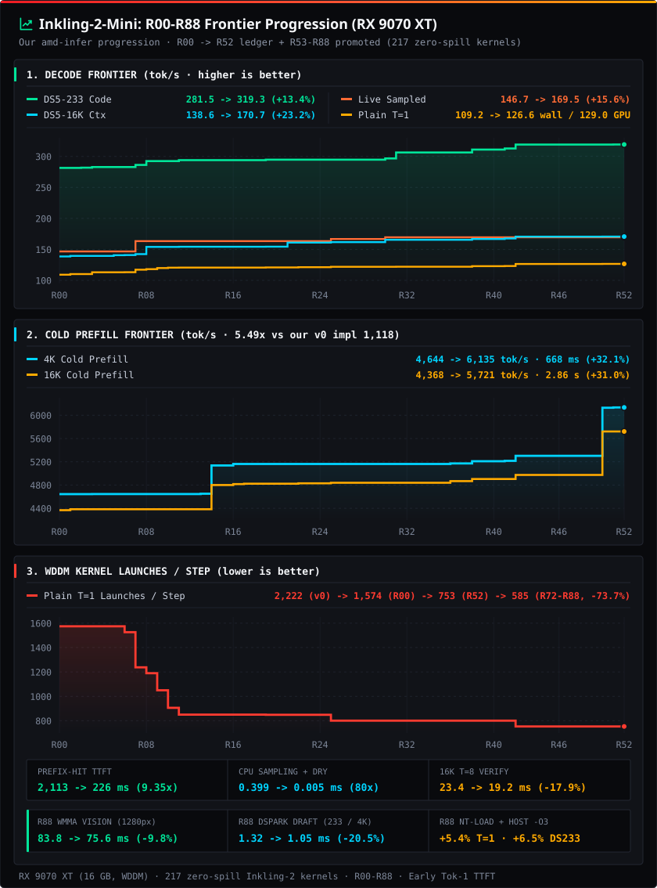
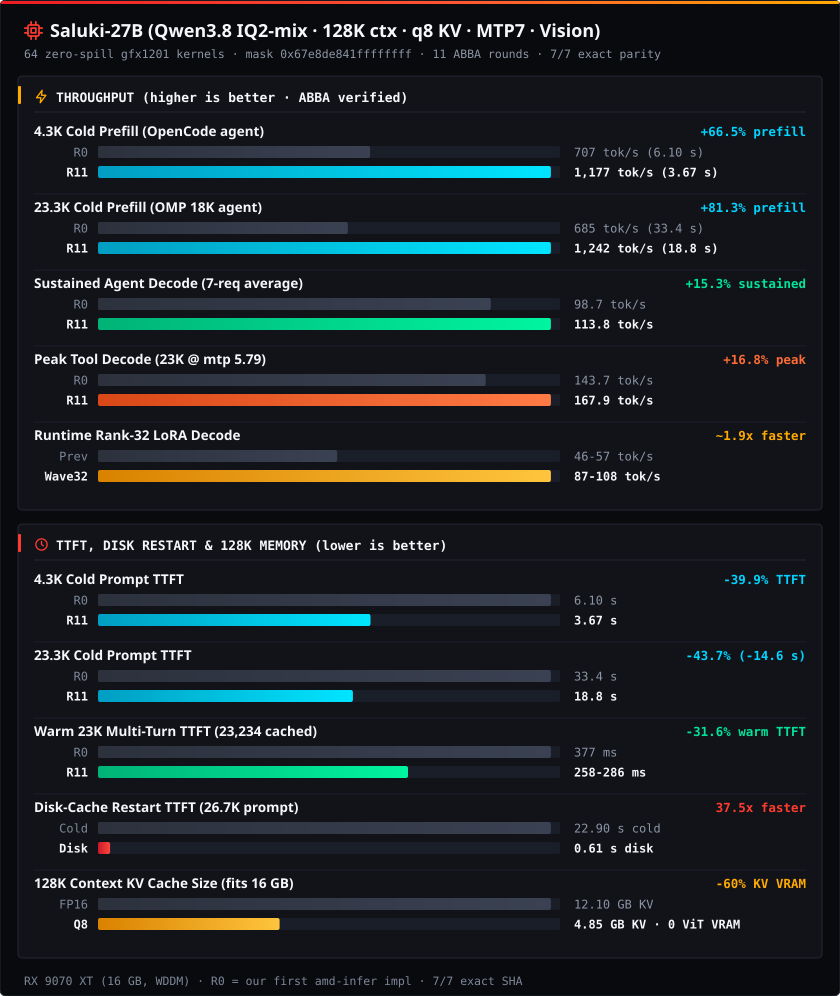

#  rdna4-amd-infer: RX 9070 XT LLM Engine

**Fast local LLM inference engine for AMD Radeon RX 9070 XT (RDNA4 / `gfx1201`) with 186 zero-spill custom AMDGPU kernels.**

Pure C11 + AMDGPU `wave32`/WMMA · **No system ROCm install on Windows** · Linux ROCm ready · GGUF v3 · OpenAI-compatible `ie-serve` API · Exact parity verified.

<p align="center">
  <a href="https://saloqt.github.io/rdna4-amd-infer/">
    
  </a>
</p>

**Exact quants tested above (single 16GB RX 9070 XT, Windows WDDM, streaming):**
- **Inkling-2-Mini (26B MoE):** `IQ3_XXS` GGUF (`output.weight` `Q4_K`), `Q4_K` DSpark 5x0.6 + 0-VRAM `60K+4K` shortlist, `f16` KV cache (64K-96K ctx)
- **Saluki-27B (`Qwen3.8-27B`):** `IQ2-mix` GGUF, `IQ3_S` MTP7 (65K draft vocab), `q8` KV cache (128K ctx) + 0-VRAM ViT vision

 **[Open Interactive 37-Round Telemetry Dashboard](https://saloqt.github.io/rdna4-amd-infer/)**: hover tooltips, frontier lines, filterable ledger, and research links for every round.

---

<p align="center">
  <a href="https://saloqt.github.io/rdna4-amd-infer/">
    
  </a>
  <br/>
  <sub><i>Click chart to open the full-screen interactive 37-round telemetry dashboard</i></sub>
</p>

---

##  RX 9070 XT Benchmarks

> Single AMD Radeon RX 9070 XT 16 GB · Windows 11 WDDM · Trace-off **true host wall clock** (not GPU-event clocks). All baselines (`v0`, `Early`, `R0`, `R00`) are our own earlier `amd-infer` implementations before each round of custom kernels, not upstream builds. Click any chart for full resolution.

### 1. Inkling-2-Mini (26B `IQ3_XXS` MoE · DSpark)

<p align="center">
  <a href="docs/inkling2-benchmarks.svg">
    
  </a>
</p>

<details>
<summary> <b>Raw Inkling-2-Mini (`IQ3_XXS`) Numbers Table</b></summary>

| Metric | First Impl (`v0` / Early) | Prior (`R00`) | **Promoted (`R37`)** | Gain |
|---|---:|---:|---:|---:|
| **Matched Snake HTML (med)** | - | - | **189.3 tok/s** (`2,625` tok, `mtp 3.83`) | Live streaming |
| **Matched OMP Prefill (28.7K)** | - | - | **3,792 tok/s** (`7.58 s` TTFT, `0` cached) | 28.7K real OMP |
| **Matched OMP Decode (30-42K)** | - | - | **148.2 tok/s** avg (`178.3` @ 42K) | `84ms` warm TTFT |
| **4K Cold Prefill** | 1,118 tok/s *(v0)* | 4,644 tok/s (`882 ms`) | **5,171 tok/s** (`792 ms`) | **4.63x** vs v0 (`5,196` A/B) |
| **16K Cold Prefill** | - | 4,368 tok/s (`3.75 s`) | **4,868 tok/s** (`3.37 s`) | **+11.5%** (`4,893` A/B) |
| **Plain `T=1` Decode** | 90.5 tok/s | 109.2 tok/s | **122.0 tok/s** (`7.99 ms` GPU) | **+34.8%** (`+11.7%` R00) |
| **DSpark Short Code (233)** | ~230 tok/s | 281.5 tok/s | **306.4 tok/s** (`1.36 ms` draft) | **+8.8%** vs R00 |
| **DSpark 16K Decode** | - | 138.6 tok/s | **165.5 tok/s** (`19.8 ms` T=8) | **+19.4%** (`-15.3%` ver) |
| **Live Sampled Chat** | 118.2 tok/s | 146.7 tok/s | **169.5 tok/s** *(greedy **185.5**)* | **+43.4%** (`+15.6%` R00) |
| **Prefix-Hit TTFT** | - | 2,113 ms (`14` tok) | **291 ms** (`8,192` tok cached) | **7.26x faster** |
| **CPU Sampling + DRY** | ~0.44 ms/step | 0.399 ms/step | **0.011 ms/step** | **36x faster** |
| **Launches / Step** | 2,222 | 1,574 | **801** | **-64.0%** (`-49.1%` R00) |
| **SWA Disk Cache** | 357.5 MB (`2.03 s`) | 181.3 MB (`1.11 s`) | **181.3 MB** *(6/6 NaN exact)* | **-49.3% size · -45.4% load** |

</details>

### 2. Saluki-27B (`Qwen3.8 IQ2-mix` · 128K · 16GB)

<p align="center">
  <a href="docs/saluki-benchmarks.svg">
    
  </a>
</p>

<details>
<summary> <b>Raw Saluki-27B (`IQ2-mix`) Numbers Table</b></summary>

| Metric | First Impl (`R0`) | **Promoted (`R11`)** | Gain |
|---|---:|---:|---:|
| **Matched Snake HTML (med)** | - | **142.1 tok/s** (`1,866` tok, `mtp 5.14`) | Live streaming |
| **Matched OMP Prefill (23.8K)** | - | **1,134 tok/s** (`21.0 s` w/ ckpts; **1,242** clean) | 23.8K real OMP |
| **Matched OMP Decode (24-40K)** | - | **109.7 tok/s** avg (**166.0** file write) | `126ms` warm TTFT |
| **4.3K Cold Prefill** | 707 tok/s (`6.10 s`) | **1,177 tok/s (`3.67 s`)** | **+66.5% · -39.9% TTFT** |
| **23.3K Cold Prefill** | 685 tok/s (`33.4 s`) | **1,242 tok/s (`18.8 s`)** | **+81.3% · -43.7% TTFT** |
| **Sustained Decode** | 98.7 tok/s | **113.8 tok/s** *(peak **167.9** @ `mtp 5.79`)* | **+15.3%** |
| **Warm 23K TTFT** | 377 ms | **258-286 ms** (`23,234 / 23,312` cached) | **-31.6%** |
| **Disk Restart (26.7K)** | 22.9 s cold | **0.61 s** *(157 MB state + KV blocks)* | **37.5x faster** |
| **Rank-32 LoRA Decode** | 46-57 tok/s | **87-108 tok/s** (`IE_LORA_WAVE32=1`) | **~1.9x faster** |

</details>

---

##  Why It's Fast on RDNA4

1. **WDDM Launch Collapse (`2,222 -> 801`):** Fusing 4 loop controllers, router+top8+sort, K/V short-conv+vclip+store, MoE tail, `CT=8` QKV/RelClip/Sink/Gate, and `W_o+sconv` cut Windows HIP retirement stall from `2.00 ms` to `0.23 ms`.
2. **3-WGs/CU RDNA4 WMMA Prefill (`5,196 tok/s`):** Largest-first `16/32/48/64` MoE tile worklist + `113-VGPR` zero-bank-conflict `IQ3_XXS+SITU` fused epilogue (`-27 GiB` 4K traffic) + zero-div Far/Near `fmha_gfx1201`.
3. **16K-32K Single-Pass WMMA Verify (`-15.3%`):** `T<=8` single-pass fp16 WMMA global attention halves 16K-32K KV reads, paired with Split-KV incremental prefill (`T=17..96`).
4. **0-VRAM `60K+4K` Shortlist + `O(1)` SAM + Zero-Sync Probabilistic DSpark:** Inkling-2 puts all 32K leading-space (`Ġ`) words in upper BPE band `149,860..199,997`; a `0.256 MiB` `id_map` cuts draft reads 3x (`99.6%` code hit, 0 MB weight copy) and `O(1)` SAM gives free `0 ms` drafts on code repeats.
5. **Prefix-Cache Immunity (`2,113 -> 291 ms`):** Ephemeral host-RAM KV stashing stops short side-requests (titles/summaries) from evicting 26K+ cached conversations (0 extra VRAM).
6. **Zero-Waste Sampling (`0.399 -> 0.011 ms`):** Fixed unpadded-vocab `topk_prefetch` cache miss + 1-launch wave32 Top-K + `O(1)` hash-chain DRY loop penalty (auto-pauses inside `<tool_call>`).

---

##  Quick Start (Windows & Linux)

### Windows (No System ROCm Install)
Needs Git Bash, MinGW `gcc`/`g++`, Python 3.12, and user-space ROCm wheels in `.rocm-venv`:
```bash
pip install rocm-sdk-core rocm-sdk-libraries rocm-sdk-device-gfx1201
```

```bash
# 1. Build host engine + all 186 custom gfx1201 kernels (0 spills)
cd engine && sh build-win.sh

# 2. Optional: shrink Inkling-2 output.weight Q8_0 -> Q4_K (-231 MB VRAM)
python ../scripts/inkling2_requant.py \
  ../models/Inkling-2-Mini-Uncensored-IQ3_XXS.gguf \
  --plan '^output\.weight$=Q4_K' \
  --out ../models/Inkling-2-Mini-Uncensored-IQ3_XXS-fast.gguf

# 3. Serve OpenAI-compatible API at http://127.0.0.1:8090/v1
powershell -File serve-inkling2.ps1   # Inkling-2-Mini (DSpark + shortlist)
powershell -File serve-saluki.ps1     # Saluki-27B (128K q8 KV + MTP7)
```

### Linux (ROCm + Clang 18+)
```bash
cd engine && make
./build/ie-serve ../models/MODEL.gguf \
  --backend gpu --hsaco build/ie_kernels.hsaco --port 8090
```

---

##  Repository Structure

| Path | Contents |
|---|---|
| [`engine/src/`](engine/src) | Pure C11 engine: GGUF v3, HIP loader, arena planner, DSpark/MTP/DFlash, disk cache, HTTP server, ViT vision |
| [`engine/kernels/`](engine/kernels) | Base `gfx1201` kernels + **122 Inkling-2** kernels + **64 Saluki-27B** kernels + ViT kernels (`0/0` VGPR spills) |
| [`engine/core/`](engine/core) & [`engine/laws/`](engine/laws) | Formally verified indexing/quantization core (`ie_core.h`) + law checks |
| [`engine/tools/`](engine/tools) & [`engine/tests/`](engine/tests) | Per-module build scripts, `objdump` checks, CPU unit, DRY, shortlist & cache tests |
| [`engine/serve-inkling2.ps1`](engine/serve-inkling2.ps1) | Production Inkling-2-Mini launcher (Q4\_K DSpark, 0-VRAM shortlist, DRY loop penalty) |
| [`engine/serve-saluki.ps1`](engine/serve-saluki.ps1) | Production Saluki-27B launcher (128K q8 KV, MTP7, ViT vision, disk prompt cache) |
| [`data/inkling2-shortlist/`](data/inkling2-shortlist) | Portable 0-VRAM `60K+4K` Inkling-2 Band-B frequency shortlist (`240 KB`) |
| [`scripts/`](scripts) | Requantizer, shortlist builder, wall-clock harness & offline HTML dashboard generator |
| [`docs/`](docs) | Live GitHub Pages dashboard ([`index.html`](docs/index.html)), 38-round JSON ledger, SVG charts & research notes |

---

<details>
<summary> <b>Promoted Kernel Masks & Rollback Controls</b></summary>

- **Inkling-2 Defaults:** `IE_INK_DEFAULT_MASK = 0xfe7dfc0369c3ffff`, `IE_INK_DEFAULT_MASK2 = 0x47f101d36b`
  - Disable all custom Inkling kernels: `IE_INKLING_KERNELS=0`
  - Individual toggles: `IE_DS_SHORTLIST=0` (full 201K head), `IE_SAM_LOOKUP=0`, `IE_EPHEMERAL_CACHE=0`, `IE_DRY_HASH=0`, `IE_DS_PROB=0`, `IE_DS_SPLIT=0`, `IE_SNAP_HOST=0`
  - Opt-in experiments kept off by default: `IE_INKLING_GRAPH=2` (piecewise HIP graphs), `IE_DS_TREE=1` (8-node tree verify), `IE_DS_FORESPARK=1`, `IE_DS_OVERLAP=1`, `IE_MK_INKLING=1`
- **Saluki-27B Defaults:** `IE_SALUKI_KERNEL_MASK = 0x67e8de841ffffffff` (64 kernels across R0-R11: `rq128`/`rq64` raw-quant WMMA, `attn_pl_r10`, `attn_long_mp_r11`, `gdn_wy_wmma_r11`, `qkn_rope_kv_r11`, `lora_b_r11`, `topk_r11`)
  - Disable all custom Saluki kernels: `IE_SALUKI_KERNELS=0`
  - KV modes: `-Kv q8` (default, 128K), `-Kv q4` (`IE_KV_Q4=1 IE_KV_ROT=1` rotated 4-bit), `-Kv f16`
- **Re-render the Interactive Dashboard:**
  ```bash
  python scripts/render_40r_dashboard.py \
    --in docs/40round-ledger.json --out docs/index.html
  ```

</details>

<details>
<summary> <b>FAQ: RX 9070 XT Local LLM, Windows ROCm & 16GB VRAM</b></summary>

- **Do I need a system ROCm install on Windows to run LLMs on an RX 9070 XT?**
  No. `engine/build-win.sh` compiles native `gfx1201` AMDGPU `.hsaco` kernels using user-space `rocm-sdk` Python wheels (`amdclang`, `ld.lld`, `hipblas.dll`) on top of standard Windows Adrenalin drivers, with no system ROCm toolkit required.
- **How do Inkling-2-Mini (26B `IQ3_XXS`) and Qwen3.8-27B (`IQ2-mix`, 128K context) fit inside 16 GB VRAM?**
  Inkling-2-Mini (`IQ3_XXS` MoE + `Q4_K` output head + `Q4_K` DSpark + 0-VRAM `60K+4K` shortlist) runs with **3.7-3.8 GB VRAM free** using on-demand growing `f16` KV cache (recommended `-Ctx 65536` when Windows desktop uses 4+ GB VRAM). Saluki-27B (`Qwen3.8-27B IQ2-mix`) uses a growing `q8` KV cache (`4.85 GB` at full 128K vs `12.1 GB` FP16, `7.8 GB` VRAM free at load) plus disk-backed prefix checkpoints and zero-VRAM ViT vision.
- **Does `ie-serve` work with Open WebUI, OpenCode, OMP, Cline, or standard OpenAI SDKs?**
  Yes. `ie-serve` exposes `/v1/chat/completions`, `/v1/models`, streaming SSE, reasoning effort (`--effort`), tool calling (`--tool-temp 0`), multimodal image inputs, and `O(1)` DRY loop-penalty protection.
- **What GPU architectures are supported?**
  The custom `186`-kernel specializations target AMD RDNA4 (`gfx1201`: Radeon RX 9070 XT / RX 9070) using native `wave32` and RDNA4 WMMA instructions. Base C11/HIP kernels can be built for other `amdgcn` targets via `ARCH=...` in `engine/Makefile`.

</details>

<details>
<summary> <b>Research Papers & Open-Source Repos Behind These Kernels</b></summary>

Full round-by-round citations are clickable inside the [Interactive Dashboard](https://saloqt.github.io/rdna4-amd-infer/) and [docs/research-summary.md](docs/research-summary.md):
- **ROCm & RDNA4 Kernels:** `ROCm/aiter` (`fmha_gfx1201`), `ROCm/composable_kernel`, AMD RDNA4 WMMA GEMM blogs, `ROCm/clr`
- **Inference Engines:** `vllm-project/vllm`, `sgl-project/sglang` (RadixAttention, Inkling-2-Mini loop fusion), `ggml-org/llama.cpp` (PR #9702, PR #32065, `iq3s_grid.h`), `flashinfer-ai/flashinfer`, `turboderp-org/exllamav3`, `Dao-AILab/causal-conv1d`, `LMCache/LMCache`
- **Speculative Decoding & MoE Papers:** DSpark (`arXiv:2607.05147`), Leviathan et al. (`arXiv:2211.17192`), FR-Spec (`arXiv:2502.14856`), MicroSpec (`arXiv:2605.26444`), SAM Decoding (`arXiv:2411.10666`), ForeSpark (`arXiv:2611.13442`), EAGLE-2 (`arXiv:2406.16858`), SonicMoE (`arXiv:2512.14080`), FlashInfer (`arXiv:2501.01005`), Mirage MPK (`arXiv:2512.22219`)

</details>

---

<sub>Built on Windows 11 + AMD Radeon RX 9070 XT (`gfx1201`). Model weights are not included: bring your own GGUFs.</sub>
