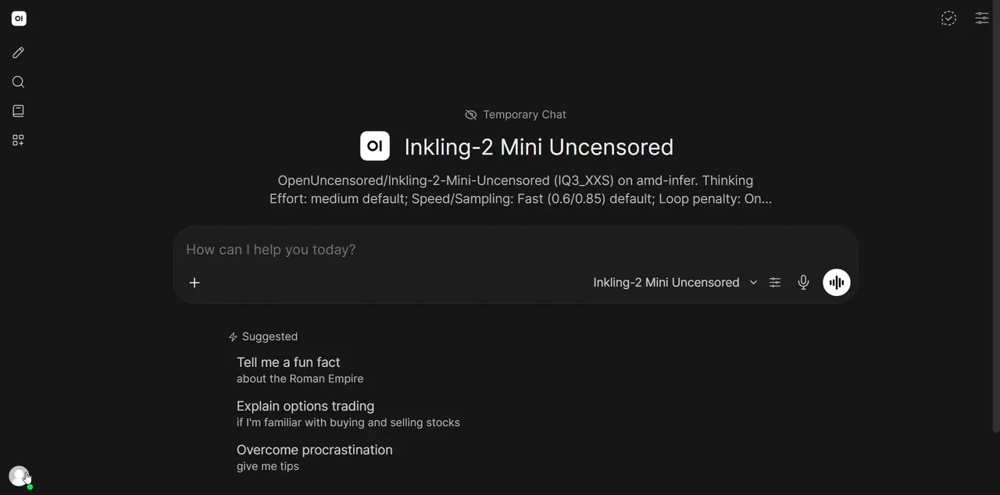

#  rdna4-amd-infer: Local LLM Inference on the AMD Radeon RX 9070 XT (RDNA4 / gfx1201)

**Run 26B-27B language models on a single 16 GB RX 9070 XT, on Windows 11 with no system ROCm install.** Inkling-2-Mini 26B decodes at up to **189 tok/s** and Saluki-27B (Qwen3.8) at **142 tok/s**, behind an OpenAI-compatible API.

[**Live dashboard**](https://saloqt.github.io/rdna4-amd-infer/) · [Watch the demo](#live-demo) · [Quick start](#quick-start-windows--linux) · [Benchmarks](#rx-9070-xt-benchmarks) · [FAQ](#faq)

  <a href="https://saloqt.github.io/rdna4-amd-infer/">
    
  </a>
</p>


## What you get

- **Fast decode and prefill:** Inkling-2-Mini `IQ3_XXS` 189.3 tok/s decode and 3,792 tok/s prefill on a 28.7K-token prompt; Saluki-27B `IQ2-mix` 142.1 tok/s and 1,134 tok/s on 23.8K.
- **Long context in 16 GB VRAM:** up to **256K filled context** with DSpark speculative decoding on Inkling-2-Mini (107.5 tok/s live at 261K tokens); 128K on Saluki-27B.
- **Image input with zero extra VRAM:** RDNA4 WMMA vision encodes an image in 29-76 ms.
- **Drop-in server:** `ie-serve` speaks the OpenAI API (`/v1/chat/completions`, streaming, tool calls) and works with Open WebUI, OpenCode, OMP, Cline and the OpenAI SDKs.
- **Windows-native:** builds with user-space ROCm wheels on the normal Adrenalin driver. Linux ROCm works too.
- **315 custom `gfx1201` kernels** (218 Inkling-2-Mini, 81 Saluki-27B, 16 vision) on top of Han Wang's [`hanw/amd.c`](https://github.com/hanw/amd.c) ([credit and license note](#credit-and-license)).

## Live demo

Unedited 1x recording of Inkling-2-Mini on one RX 9070 XT, rendering a live 3D Rubik's Cube while the same GPU captures the video: **3,882 tokens in 35.6 s (109 tok/s)**.

<p align="center">
  <a href="https://github.com/SaloQT/rdna4-amd-infer/releases/download/media-demo/inkling2-live-demo-1080p.mp4">
    
  </a>
  <br/>
  <sub><i>Click for the full 1080p 30 fps MP4 (8.6 MB).</i></sub>
</p>

## Quick start (Windows & Linux)

### Windows (No System ROCm Install)
Needs Git Bash, MinGW `gcc`/`g++`, Python 3.12, and user-space ROCm wheels in `.rocm-venv`:
```bash
pip install rocm-sdk-core rocm-sdk-libraries rocm-sdk-device-gfx1201
```

```bash
# 1. Build host engine + all 315 custom gfx1201 kernels (0 Inkling-2/vision spills)
cd engine && sh build-win.sh

# 2. Optional: shrink Inkling-2 output.weight Q8_0 -> Q4_K (-231 MB VRAM)
python ../scripts/inkling2_requant.py \
  ../models/Inkling-2-Mini-Uncensored-IQ3_XXS.gguf \
  --plan '^output\.weight$=Q4_K' \
  --out ../models/Inkling-2-Mini-Uncensored-IQ3_XXS-fast.gguf

# 3. Serve OpenAI-compatible API at http://127.0.0.1:8090/v1
powershell -File serve-inkling2.ps1              # Inkling-2-Mini (96K f16 KV + DSpark + shortlist)
powershell -File serve-inkling2.ps1 -Ctx 262144  # Inkling-2-Mini (256K q4rot global KV + DSpark)
powershell -File serve-saluki.ps1                # Saluki-27B (128K q8 KV + MTP7)
```

### Linux (ROCm + Clang 18+)
```bash
cd engine && make
./build/ie-serve ../models/MODEL.gguf \
  --backend gpu --hsaco build/ie_kernels.hsaco --port 8090
```

Model weights are not included: bring your own GGUFs. Long-context and vision options are in the [technical notes](docs/technical-notes.md).

##  RX 9070 XT benchmarks

All numbers are true host wall clock on one RX 9070 XT 16 GB (Windows 11 WDDM). Baselines (`v0`, `Early`, `R0`, `R00`) are our own earlier `amd-infer` builds, not upstream. Click any chart to enlarge.

### Progress over 89 optimization rounds

<p align="center">
  <a href="https://saloqt.github.io/rdna4-amd-infer/">
    
  </a>
  <br/>
  <sub><i>Click chart to open the full-screen interactive 89-round telemetry dashboard (R00-R89)</i></sub>
</p>

### Inkling-2-Mini (26B `IQ3_XXS` MoE with DSpark)

<p align="center">
  <a href="docs/inkling2-benchmarks.svg">
    
  </a>
</p>

<details>
<summary> <b>Raw Inkling-2-Mini (`IQ3_XXS`) Numbers Table (R00-R89)</b></summary>

| Metric | First Impl (`v0` / Early) | Prior (`R00`) | **Promoted (`R51 - R89`)** | Gain |
|---|---:|---:|---:|---:|
| **Matched Snake HTML (med)** | - | - | **189.3 tok/s** (`2,625` tok, `mtp 3.83`, R37 ref) | Live streaming |
| **Matched OMP Prefill (28.7K)** | - | - | **3,792 tok/s** (`7.58 s` TTFT, `0` cached, R37 ref) | 28.7K real OMP |
| **Matched OMP Decode (30-42K)** | - | - | **148.2 tok/s** avg (`178.3` @ 42K, R37 ref) | `84ms` warm TTFT |
| **4K Cold Prefill (`chunk=1024`)** | 1,118 tok/s *(v0)* | 4,644 tok/s (`882 ms`) | **6,135 tok/s** (`668 ms`) | **5.49x** vs v0 (`+32.1%` R00) |
| **16K Cold Prefill (`chunk=1024`)** | - | 4,368 tok/s (`3.75 s`) | **5,716 tok/s** (`2.87 s`; `5,721` R50) | **+30.9%** vs R00 |
| **Plain `T=1` Decode** | 90.5 tok/s | 109.2 tok/s | **127.3 tok/s** (`7.65 ms` GPU, R89; `126.6` R51) | **+40.6%** (`+16.6%` R00) |
| **DSpark Short Code (233)** | ~230 tok/s | 281.5 tok/s | **320.0 tok/s** (`1.01 ms` draft, `19.9 ms` ver, R89; `319.3` R51) | **+13.7%** vs R00 |
| **DSpark 16K Decode** | - | 138.6 tok/s | **170.7 tok/s** (`170.5` R89, `17.5 ms` T=8) | **+23.2%** (`-25.0%` ver) |
| **Live `ie-serve` Chat** | 118.2 tok/s | 146.7 tok/s | **169.5 tok/s** sampled *(greedy **191.2**)* | **+43.4%** (`+14.7%` greedy) |
| **Prefix-Hit TTFT** | - | 2,113 ms (`14` tok) | **226 ms** (`8,192` tok cached) | **9.35x faster** |
| **CPU Sampling + DRY** | ~0.44 ms/step | 0.399 ms/step | **0.005 ms/step** (`0.006` R51) | **80x faster** |
| **Launches / Step** | 2,222 | 1,574 | **585** (`753` R52, `0.453 ms` issue) | **-73.7%** (`-62.8%` R00) |
| **SWA Disk Cache & Resume (`20K` Q4rot)** | 357.5 MB (`2.03 s`) | 181.3 MB (`1.11 s`) | **`-40.4%` cold / `-61.1%` prewarm** (`275 -> 164 / 107 ms`, `IoRing` + H2D pipe) | **1.68x - 2.57x faster** |
| **256K Prompt BPE (`261.6K` tok)** | - | `16.93 ms` (1T) | **`3.87 ms`** (4T stack BPE + seg cache, bit-exact) | **4.37x faster** |

</details>

**256K filled context, Inkling-2-Mini (vs the R52 baseline):**

| Metric | R52 | R89 | Gain |
|---|---:|---:|---:|
| Cold fill of 261,632 tokens | 227 s | **106 s** | 2.14x faster |
| Time to first token (`inc256`) | 600-630 ms | **229 ms** | 2.75x faster |
| Live `ie-serve` decode with DSpark | 54.5 tok/s | **107.5 tok/s** greedy / **137.0** sampled | up to 2.51x |
| Free VRAM headroom (DXGI reserve) | +870 MiB | **+1,731 to +2,089 MiB** | 2.7-3.3x above the 640 MiB gate |

Full 256K table, vision encoder numbers and the kernel-level "why it is fast" write-up: [docs/technical-notes.md](docs/technical-notes.md).

### Saluki-27B (`Qwen3.8 IQ2-mix`, 128K, 16 GB)

<p align="center">
  <a href="docs/saluki-benchmarks.svg">
    
  </a>
</p>

<details>
<summary> <b>Raw Saluki-27B (`IQ2-mix`) Numbers Table</b></summary>

| Metric | First Impl (`R0`) | **Promoted (`R11`)** | Gain |
|---|---:|---:|---:|
| **Matched Snake HTML (med)** | - | **142.1 tok/s** (`1,866` tok, `mtp 5.14`) | Live streaming |
| **Matched OMP Prefill (23.8K)** | - | **1,134 tok/s** (`21.0 s` w/ ckpts; **1,242** clean) | 23.8K real OMP |
| **Matched OMP Decode (24-40K)** | - | **109.7 tok/s** avg (**166.0** file write) | `126ms` warm TTFT |
| **4.3K Cold Prefill** | 707 tok/s (`6.10 s`) | **1,177 tok/s (`3.67 s`)** | **+66.5% · -39.9% TTFT** |
| **23.3K Cold Prefill** | 685 tok/s (`33.4 s`) | **1,242 tok/s (`18.8 s`)** | **+81.3% · -43.7% TTFT** |
| **Sustained Decode** | 98.7 tok/s | **113.8 tok/s** *(peak **167.9** @ `mtp 5.79`)* | **+15.3%** |
| **Warm 23K TTFT** | 377 ms | **258-286 ms** (`23,234 / 23,312` cached) | **-31.6%** |
| **Disk Restart (26.7K)** | 22.9 s cold | **0.61 s** *(157 MB state + KV blocks)* | **37.5x faster** |
| **Rank-32 LoRA Decode** | 46-57 tok/s | **87-108 tok/s** (`IE_LORA_WAVE32=1`) | **~1.9x faster** |

</details>

## Go deeper

- [Interactive dashboard](https://saloqt.github.io/rdna4-amd-infer/): hover tooltips, frontier lines, 256K charts and a filterable ledger for every round (`R00-R89`)
- [Technical notes](docs/technical-notes.md): 256K long context, zero-VRAM vision, why each kernel is fast
- [Kernel masks and rollback switches](docs/kernel-controls.md): turn any promoted kernel off with an environment variable
- [Research summary](docs/research-summary.md) and [round ledger](docs/40round-ledger.json)

##  Repository structure

| Path | Contents |
|---|---|
| [`engine/src/`](engine/src) | C11 engine: GGUF v3, HIP loader, arena planner, DSpark/MTP, disk cache, HTTP server, vision |
| [`engine/kernels/`](engine/kernels) | Custom `gfx1201` kernels: 218 Inkling-2, 81 Saluki-27B, 16 vision (10 WMMA) |
| [`engine/core/`](engine/core) & [`engine/laws/`](engine/laws) | Formally verified indexing/quantization core from [`hanw/amd.c`](https://github.com/hanw/amd.c) |
| [`engine/tools/`](engine/tools) & [`engine/tests/`](engine/tests) | Build scripts, `objdump` spill checks, CPU, DRY, shortlist, vision and cache tests |
| [`engine/serve-inkling2.ps1`](engine/serve-inkling2.ps1) · [`engine/serve-saluki.ps1`](engine/serve-saluki.ps1) | Server launchers with the tuned defaults |
| [`data/inkling2-shortlist/`](data/inkling2-shortlist) | Portable DSpark vocabulary shortlists (112 KB + 240 KB) |
| [`scripts/`](scripts) | Requantizer, shortlist builder, benchmark harness, dashboard and chart generators |
| [`docs/`](docs) | GitHub Pages dashboard, round ledger, charts, research notes |

## FAQ

<details>
<summary><b>Do I need a system ROCm install on Windows?</b></summary>

No. `engine/build-win.sh` compiles the `gfx1201` kernels with user-space `rocm-sdk` Python wheels (`amdclang`, `ld.lld`, `hipblas.dll`) on top of the standard Adrenalin driver.
</details>

<details>
<summary><b>How do 26B-27B models and 256K context fit in 16 GB?</b></summary>

At 64K-96K context Inkling-2-Mini leaves 3.7-3.9 GB of VRAM free. For 256K, `-Ctx 262144` stores the 8 global KV layers as `Q4_0` with a Hadamard rotation (2,304 MiB), rings DSpark's KV, and keeps rarely used MoE layers in host RAM behind a VRAM expert cache. Saluki-27B uses a `q8` KV cache for 128K. Details: [technical notes](docs/technical-notes.md).
</details>

<details>
<summary><b>Does it work with Open WebUI, OpenCode, OMP, Cline or the OpenAI SDK?</b></summary>

Yes. `ie-serve` exposes `/v1/chat/completions` and `/v1/models` with streaming, reasoning effort (`--effort`), tool calling (`--tool-temp 0`), image input and a loop penalty (DRY) that pauses inside tool calls.
</details>

<details>
<summary><b>Which GPUs are supported?</b></summary>

The custom kernels target the RDNA4 `gfx1201` (Radeon RX 9070 XT / RX 9070) with native `wave32` and WMMA. The base HIP kernels can be built for other `amdgcn` targets with `GPU_ARCH=...` in `engine/Makefile`.
</details>

<details>
<summary><b>What is upstream and what was added here?</b></summary>

The C11 engine, verified core, Lean laws, base `gfx1201` kernels and `ie-serve` come from [`hanw/amd.c`](https://github.com/hanw/amd.c). This repo adds the Windows 11 WDDM port, raw `IQ1_S`/`IQ1_M`/`IQ2_*`/`IQ3_XXS`/`Q2_K` loaders, the 315 custom kernels, DSpark with the vocabulary shortlist, 256K long context and zero-VRAM vision.
</details>

<details>
<summary> <b>Research Papers & Open-Source Repos Behind These Kernels</b></summary>

Full round-by-round citations are clickable inside the [Interactive Dashboard](https://saloqt.github.io/rdna4-amd-infer/) and [docs/research-summary.md](docs/research-summary.md):
- **Base Engine:** [`hanw/amd.c`](https://github.com/hanw/amd.c) (Han Wang's from-scratch C11 `gfx1201` inference engine & formally verified core)
- **ROCm & RDNA4 Kernels:** `ROCm/aiter` (`fmha_gfx1201`), `ROCm/composable_kernel`, AMD RDNA4 WMMA GEMM blogs, `ROCm/clr`
- **Inference Engines:** `vllm-project/vllm`, `sgl-project/sglang` (RadixAttention, Inkling-2-Mini loop fusion), `ggml-org/llama.cpp` (PR #9702, PR #32065, `iq3s_grid.h`), `flashinfer-ai/flashinfer`, `turboderp-org/exllamav3`, `Dao-AILab/causal-conv1d`, `LMCache/LMCache`
- **Speculative Decoding & MoE Papers:** DSpark (`arXiv:2607.05147`), Leviathan et al. (`arXiv:2211.17192`), FR-Spec (`arXiv:2502.14856`), MicroSpec (`arXiv:2605.26444`), SAM Decoding (`arXiv:2411.10666`), ForeSpark (`arXiv:2611.13442`), EAGLE-2 (`arXiv:2406.16858`), SonicMoE (`arXiv:2512.14080`), FlashInfer (`arXiv:2501.01005`), Mirage MPK (`arXiv:2512.22219`)

</details>

## Credit and license

The base C11 runtime, formally verified core (`engine/core/ie_core.h`), base `gfx1201` kernels and `ie-serve` architecture come from Han Wang's [`hanw/amd.c`](https://github.com/hanw/amd.c), and `engine/src/iq3s_grid.h` carries ggml's MIT header. Upstream has no `LICENSE` file, so this repository does not apply a separate open-source license over that code. If upstream adds a license or asks for changes or removal, this repo will follow.

---

<sub>Built on Windows 11 with an AMD Radeon RX 9070 XT (`gfx1201`) on top of [`hanw/amd.c`](https://github.com/hanw/amd.c).</sub>
