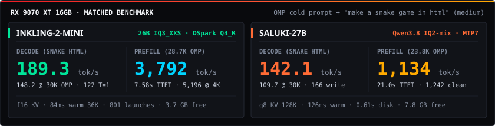
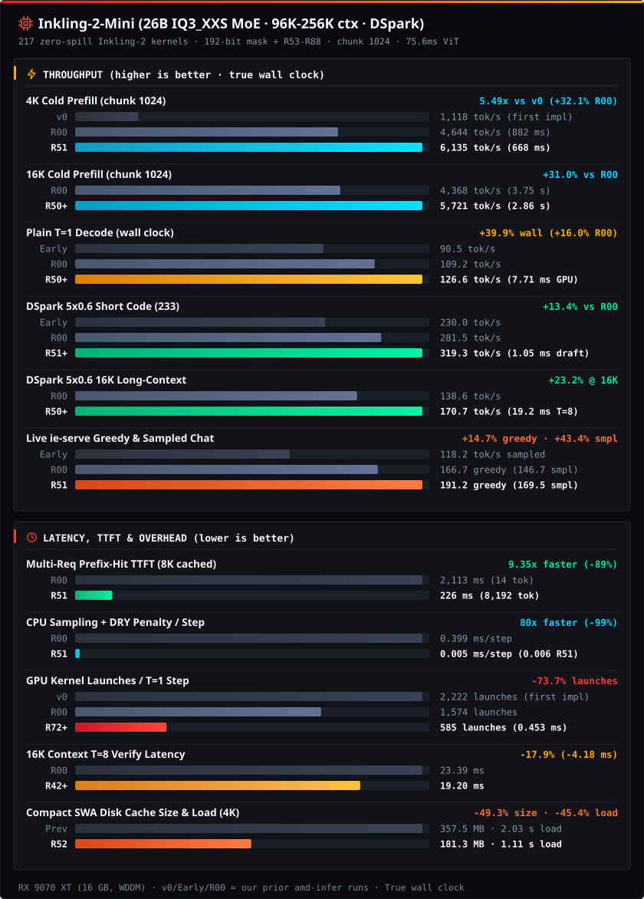

#  rdna4-amd-infer: RX 9070 XT LLM Engine

**Fast local LLM inference engine for AMD Radeon RX 9070 XT (RDNA4 / `gfx1201`) built on top of Han Wang's [`hanw/amd.c`](https://github.com/hanw/amd.c), adding Windows 11 WDDM support (no system ROCm install) and 264 custom AMDGPU kernels (`171` Inkling-2-Mini with `0/0` VGPR spills, `81` Saluki-27B, `12` ViT vision including `6` RDNA4 WMMA).**

Base C11 engine & verified core by [`hanw/amd.c`](https://github.com/hanw/amd.c) · Windows WDDM port + 264 custom `gfx1201` kernels + DSpark/shortlist/256K long-context/0-VRAM WMMA vision/dashboard added here · Linux ROCm ready · GGUF v3 · OpenAI-compatible `ie-serve` API.

> **Upstream Credit & License Note:** The base C11 runtime, formally verified core (`engine/core/ie_core.h`), base `gfx1201` kernels, and `ie-serve` architecture come from Han Wang's [`hanw/amd.c`](https://github.com/hanw/amd.c) (and `engine/src/iq3s_grid.h` carries ggml's MIT header). Because upstream `hanw/amd.c` does not currently include a `LICENSE` file, this repository intentionally does **not** apply a separate open-source license over Han's upstream code. All credit for the base engine belongs to Han Wang; if upstream adds a license (or requests changes/removal of upstream files), this repo will follow immediately.

<p align="center">
  <a href="https://saloqt.github.io/rdna4-amd-infer/">
    
  </a>
</p>

**Exact quants tested above (single 16GB RX 9070 XT, Windows WDDM, streaming):**
- **Inkling-2-Mini (26B MoE):** `IQ3_XXS` GGUF (`output.weight` `Q4_K`), `Q4_K` DSpark 5x0.6 + 0-VRAM `60K+4K` shortlist, `f16` KV cache (default 96K ctx; up to **256K filled ctx + DSpark** with global `q4rot` KV + outer-layer SLRU MoE cache) + **0-VRAM RDNA4 WMMA ViT vision** (`28.4 - 83.8 ms`)
- **Saluki-27B (`Qwen3.8-27B`):** `IQ2-mix` GGUF, `IQ3_S` MTP7 (65K draft vocab), `q8` KV cache (128K ctx) + 0-VRAM ViT vision

 **[Open Interactive 52-Round Telemetry Dashboard](https://saloqt.github.io/rdna4-amd-infer/)**: hover tooltips, frontier lines, filterable ledger, and research links for every round (`R00-R52`).

---

## Live Real-Time Demo (1x Speed, RX 9070 XT 16 GB)

Unedited 1x screen recording of `Inkling-2-Mini` (`26B IQ3_XXS`, `Q4_K` DSpark, `temp 0.6 / top_p 0.85 / top_k 20`, medium reasoning) running locally via `ie-serve` + Open WebUI on a single RX 9070 XT 16 GB (Windows WDDM, simultaneously capturing video on the same GPU): `3,882` output tokens in `35.62 s` (`109.0 tok/s`, `3.25` tok/step) generating and rendering a live 3D Rubik's Cube.

<p align="center">
  <a href="https://github.com/SaloQT/rdna4-amd-infer/releases/download/media-demo/inkling2-live-demo-1080p.mp4">
    
  </a>
  <br/>
  <sub><i>Auto-playing 24-bit animated WebP (1280x634, 12 fps, real-time 1x) · <a href="https://github.com/SaloQT/rdna4-amd-infer/releases/download/media-demo/inkling2-live-demo-1080p.mp4">Watch / download full 1920x950 30 fps H.264 MP4 (8.6 MB)</a></i></sub>
</p>

---

<p align="center">
  <a href="https://saloqt.github.io/rdna4-amd-infer/">
    
  </a>
  <br/>
  <sub><i>Click chart to open the full-screen interactive 52-round telemetry dashboard</i></sub>
</p>

---

##  RX 9070 XT Benchmarks

> Single AMD Radeon RX 9070 XT 16 GB · Windows 11 WDDM · Trace-off **true host wall clock** (not GPU-event clocks). All baselines (`v0`, `Early`, `R0`, `R00`) are our own earlier `amd-infer` implementations before each round of custom kernels, not upstream builds. Click any chart for full resolution.

### 1. Inkling-2-Mini (26B `IQ3_XXS` MoE · DSpark)

<p align="center">
  <a href="docs/inkling2-benchmarks.svg">
    
  </a>
</p>

<details>
<summary> <b>Raw Inkling-2-Mini (`IQ3_XXS`) Numbers Table (R00-R52)</b></summary>

| Metric | First Impl (`v0` / Early) | Prior (`R00`) | **Promoted (`R51/R52`)** | Gain |
|---|---:|---:|---:|---:|
| **Matched Snake HTML (med)** | - | - | **189.3 tok/s** (`2,625` tok, `mtp 3.83`, R37 ref) | Live streaming |
| **Matched OMP Prefill (28.7K)** | - | - | **3,792 tok/s** (`7.58 s` TTFT, `0` cached, R37 ref) | 28.7K real OMP |
| **Matched OMP Decode (30-42K)** | - | - | **148.2 tok/s** avg (`178.3` @ 42K, R37 ref) | `84ms` warm TTFT |
| **4K Cold Prefill (`chunk=1024`)** | 1,118 tok/s *(v0)* | 4,644 tok/s (`882 ms`) | **6,135 tok/s** (`668 ms`) | **5.49x** vs v0 (`+32.1%` R00) |
| **16K Cold Prefill (`chunk=1024`)** | - | 4,368 tok/s (`3.75 s`) | **5,716 tok/s** (`2.87 s`; `5,721` R50) | **+30.9%** vs R00 |
| **Plain `T=1` Decode** | 90.5 tok/s | 109.2 tok/s | **126.6 tok/s** (`7.71 ms` GPU; `126.5` R52) | **+39.9%** (`+16.0%` R00) |
| **DSpark Short Code (233)** | ~230 tok/s | 281.5 tok/s | **319.3 tok/s** (`1.32 ms` draft, `19.6 ms` ver) | **+13.4%** vs R00 |
| **DSpark 16K Decode** | - | 138.6 tok/s | **170.7 tok/s** (`19.2 ms` T=8; `170.3` R52) | **+23.2%** (`-17.9%` ver) |
| **Live `ie-serve` Chat** | 118.2 tok/s | 146.7 tok/s | **169.5 tok/s** sampled *(greedy **191.2**)* | **+43.4%** (`+14.7%` greedy) |
| **Prefix-Hit TTFT** | - | 2,113 ms (`14` tok) | **226 ms** (`8,192` tok cached) | **9.35x faster** |
| **CPU Sampling + DRY** | ~0.44 ms/step | 0.399 ms/step | **0.005 ms/step** (`0.006` R51) | **80x faster** |
| **Launches / Step** | 2,222 | 1,574 | **753** | **-66.1%** (`-52.2%` R00) |
| **SWA Disk Cache** | 357.5 MB (`2.03 s`) | 181.3 MB (`1.11 s`) | **181.3 MB** *(6/6 NaN exact)* | **-49.3% size · -45.4% load** |

</details>

### 1b. Filled 128K & 256K Context + DSpark on 16 GB VRAM (Inkling-2-Mini)

Inkling-2-Mini (`26B IQ3_XXS`) also supports **filled 128K and 256K context with DSpark active inside 16 GB VRAM** on Windows WDDM without swapping or spilling past DXGI budget:
- **Global-only `Q4_0 + FWHT-128` KV (`IE_INK_GLOB_KV=q4rot`):** Quantizes only the 8 global KV layers to 72 B/head (`2,304 MiB` exact at 256K, 4K KLD `0.004511`, `98.91%` top-1, ppl `1.2024` vs `1.2015` f16) while all 40 SWA layers stay `f16` and DSpark stays active.
- **Ringed DSpark Global KV + On-the-Fly RoPE (`IE_DS_GLOB_WIN=8192`, `IE_DS_ROPE_OTF=1`):** Caps DSpark's global KV layer to an `8K` ring (16K physical ring = `64 MiB`) and replaces the `127.5 MiB` `f32` RoPE table with exact FP64 Cody-Waite range reduction (auto-on at `--ctx >= 131072`).
- **Outer-Layer Host-Backed SLRU MoE Expert Cache (`IE_MOE_CACHE_SLOTS=auto`):** Pins only the outer layers (`blk.0..5, 18..23`) in host RAM with a VRAM SLRU expert cache (`82.2%` hit rate at 256K) while keeping all 12 core looped layers (`blk.6..17`, visited 3x per token) and all 24 dense layers 100% VRAM-resident.

| Filled Context (`IQ3_XXS` · 16 GB WDDM) | Plain Decode | **DSpark 5x0.6** | Gain | `inc256` TTFT | Worst DXGI Reserve | Needle Recall (5%/50%/95%) |
|---|---:|---:|---:|---:|---:|---:|
| **128K Filled (`130,500` tok, `ie-serve`)** | 53.7 tok/s | **90.2 tok/s** (`90.1` `ie-run`, `4.38` tok/step) | **+68.0% (`1.68x`)** | `405 ms` | `+1,997 MiB` (`10.76 / 12.71 GiB`) | **3 / 3** |
| **256K Filled (`261,632` tok, `ie-serve`)** | 38.3 tok/s | **54.5 tok/s** (`46.5` `ie-run`, `2.72` tok/step) | **+42.3% (`1.42x`)** | `600 ms` (`0.70 s` TTFT) | `+870 MiB` (`11.89 / 12.74 GiB`) | **3 / 3** |

```powershell
# Automatic 256K + DSpark profile (sets -Chunk 512, q4rot global KV, 8K DSpark ring, OTF RoPE, auto MoE SLRU):
powershell -File serve-inkling2.ps1 -Ctx 262144

# Opt-in 128K + DSpark low-VRAM profile:
powershell -File serve-inkling2.ps1 -Ctx 131072 -GlobKv q4rot -DsGlobWin 8192 -MoeCacheSlots auto
```

### 1c. Zero-Persistent-VRAM RDNA4 WMMA Vision (Inkling-2-Mini `inkling2v`)

Inkling-2-Mini (`OpenUncensored/Inkling-2-Mini-Uncensored`) supports native multimodal image input via 6 custom RDNA4 (`gfx1201`) WMMA vision kernels ([`engine/kernels/ie_vision_wmma_r14.inc`](engine/kernels/ie_vision_wmma_r14.inc): FP16 & Q8_0 WMMA GEMM, inline 2D Axial RoPE `hd=64` WMMA FlashAttention, fused LayerNorm, patch-prep, and 2x2 spatial merge; all 6 at `<= 94` VGPR, `0/0` spills, `4` WGs/CU):
- **Zero persistent VRAM (`0.00 MiB` delta):** Double-buffered async H2D weight streaming borrows Inkling-2's idle LLM prefill arena inside `ie-serve` (`102.8 MiB` peak at `1280x1280` `Q8_0` inside the `140.0 MiB` 256K arena; fixed 4 MiB VMM fallback standalone). Live 256K `ie-serve` DXGI stayed flat at `11.04 / 12.15 GiB` (`+1.11 GiB` reserve, `0.00 MiB` leak across mixed resolutions).
- **24.4x faster than scalar ViT (`Q8_0` default):** Download [`mmproj-Inkling-2-Mini-Q8_0.gguf`](https://huggingface.co/AtomicChat/Inkling-2-Mini-GGUF) (`346 MB`, default; `1.12x - 1.74x` faster than F16 over PCIe) or [`mmproj-Inkling-2-Mini-Uncensored-F16.gguf`](https://huggingface.co/AtomicChat/Inkling-2-Mini-Uncensored-GGUF) (`639 MB`, fallback) into `models/`. `serve-inkling2.ps1` auto-detects it (`-Mmproj PATH` / `-NoVision` overrides).

| Resolution (`inkling2v` `Q8_0`) | Merged Tokens | WMMA Encode Latency | CPU vs GPU Cosine | Live E2E (`64K` / `256K q4rot` + DSpark) |
|---|---:|---:|---:|---|
| **`640x640`** (`16x16`) | `256` tok | **`28.4 ms`** | `0.999989` | **5/5 PASS** (OCR, spatial color/shape, bar chart, |
| **`1040x1040`** (`26x26`) | `676` tok | **`53.4 ms`** | `0.999989` | 2x2 hi-res grid, multi-turn vision+KV cache hit); |
| **`1280x1280`** (`32x32`) | `1,024` tok | **`83.8 ms`** (`24.4x` vs scalar) | `0.999985 - 0.999998` | `155 - 215 tok/s` (64K), `121 - 165 tok/s` (256K) |

### 2. Saluki-27B (`Qwen3.8 IQ2-mix` · 128K · 16GB)

<p align="center">
  <a href="docs/saluki-benchmarks.svg">
    
  </a>
</p>

<details>
<summary> <b>Raw Saluki-27B (`IQ2-mix`) Numbers Table</b></summary>

| Metric | First Impl (`R0`) | **Promoted (`R11`)** | Gain |
|---|---:|---:|---:|
| **Matched Snake HTML (med)** | - | **142.1 tok/s** (`1,866` tok, `mtp 5.14`) | Live streaming |
| **Matched OMP Prefill (23.8K)** | - | **1,134 tok/s** (`21.0 s` w/ ckpts; **1,242** clean) | 23.8K real OMP |
| **Matched OMP Decode (24-40K)** | - | **109.7 tok/s** avg (**166.0** file write) | `126ms` warm TTFT |
| **4.3K Cold Prefill** | 707 tok/s (`6.10 s`) | **1,177 tok/s (`3.67 s`)** | **+66.5% · -39.9% TTFT** |
| **23.3K Cold Prefill** | 685 tok/s (`33.4 s`) | **1,242 tok/s (`18.8 s`)** | **+81.3% · -43.7% TTFT** |
| **Sustained Decode** | 98.7 tok/s | **113.8 tok/s** *(peak **167.9** @ `mtp 5.79`)* | **+15.3%** |
| **Warm 23K TTFT** | 377 ms | **258-286 ms** (`23,234 / 23,312` cached) | **-31.6%** |
| **Disk Restart (26.7K)** | 22.9 s cold | **0.61 s** *(157 MB state + KV blocks)* | **37.5x faster** |
| **Rank-32 LoRA Decode** | 46-57 tok/s | **87-108 tok/s** (`IE_LORA_WAVE32=1`) | **~1.9x faster** |

</details>

---

##  Why It's Fast on RDNA4

1. **WDDM Launch Collapse (`2,222 -> 753`):** Fusing 4 loop controllers, router+top8+sort, K/V short-conv+vclip+store, MoE tail, `CT=8` QKV/RelClip/Sink/Gate, `W_o+sconv`, and FLUTE `IQ3_XXS` expert paths cut Windows HIP retirement stall from `2.00 ms` to under `0.22 ms`.
2. **0-VRAM FLUTE SoA `IQ3_XXS` Repack (`R42`):** Load-time SoA transpose of `IQ3_XXS` MoE expert weights eliminates bit-unpack stalls across decode, verify, and prefill (`+3.5%` decode, `-48` launches/step, zero extra VRAM).
3. **`chunk=1024` RDNA4 WMMA Prefill (`6,135 tok/s`):** Largest-first `16/32/48/64` MoE tile worklist + `113-VGPR` zero-bank-conflict `IQ3_XXS+SITU` fused epilogue + `chunk=1024` lift guarded by `gpu_chunk_clamp()` (`5.49x` vs our `v0` impl).
4. **16K-256K Attention & Outer-Layer SLRU Cache:** `T<=8` single-pass fp16 WMMA global attention (`-17.9%` 16K verify), global-only `Q4_0 + FWHT-128` KV (`2,304 MiB` at 256K), and host-backed outer-layer SLRU expert cache (`82.2%` hit rate) keep 128K (`90.2 tok/s`) and 256K (`54.5 tok/s`) DSpark inside 16 GB VRAM.
5. **0-VRAM `60K+4K` Shortlist + `O(1)` SAM + Zero-Sync Probabilistic DSpark:** Inkling-2 puts all 32K leading-space (`Ġ`) words in upper BPE band `149,860..199,997`; a `0.256 MiB` `id_map` cuts draft reads 3x (`99.6%` code hit, 0 MB weight copy) and `O(1)` SAM gives free `0 ms` drafts on code repeats.
6. **Prefix-Cache Immunity + Deferred Checkpoints + Zero-Pacer First Token (`2,113 -> 226 ms`):** Ephemeral host-RAM KV stashing protects cached conversations from short side-requests; `IE_DEFER_CKSAVE=2` overlaps post-token-1 checkpoint saves via async SWA ring copies, and `IE_PACE_FIRST_FAST=1` streams the first SSE token immediately.
7. **Zero-Waste Sampling (`0.399 -> 0.005 ms`):** Fixed unpadded-vocab `topk_prefetch` cache miss + 1-launch wave32 Top-K + `O(1)` hash-chain DRY loop penalty (auto-pauses inside `<tool_call>`).

---

##  Quick Start (Windows & Linux)

### Windows (No System ROCm Install)
Needs Git Bash, MinGW `gcc`/`g++`, Python 3.12, and user-space ROCm wheels in `.rocm-venv`:
```bash
pip install rocm-sdk-core rocm-sdk-libraries rocm-sdk-device-gfx1201
```

```bash
# 1. Build host engine + all 264 custom gfx1201 kernels (0 Inkling-2/vision spills)
cd engine && sh build-win.sh

# 2. Optional: shrink Inkling-2 output.weight Q8_0 -> Q4_K (-231 MB VRAM)
python ../scripts/inkling2_requant.py \
  ../models/Inkling-2-Mini-Uncensored-IQ3_XXS.gguf \
  --plan '^output\.weight$=Q4_K' \
  --out ../models/Inkling-2-Mini-Uncensored-IQ3_XXS-fast.gguf

# 3. Serve OpenAI-compatible API at http://127.0.0.1:8090/v1
powershell -File serve-inkling2.ps1              # Inkling-2-Mini (96K f16 KV + DSpark + shortlist)
powershell -File serve-inkling2.ps1 -Ctx 262144  # Inkling-2-Mini (256K q4rot global KV + DSpark)
powershell -File serve-saluki.ps1                # Saluki-27B (128K q8 KV + MTP7)
```

### Linux (ROCm + Clang 18+)
```bash
cd engine && make
./build/ie-serve ../models/MODEL.gguf \
  --backend gpu --hsaco build/ie_kernels.hsaco --port 8090
```

---

##  Repository Structure

| Path | Contents |
|---|---|
| [`engine/src/`](engine/src) | Pure C11 engine (based on [`hanw/amd.c`](https://github.com/hanw/amd.c)): GGUF v3, HIP loader, arena planner, DSpark/MTP/DFlash, disk cache, HTTP server, ViT vision |
| [`engine/kernels/`](engine/kernels) | Base `gfx1201` kernels (`hanw/amd.c`) + **171 Inkling-2** (`0/0` spills) + **81 Saluki-27B** + **12 ViT** (`6` RDNA4 WMMA + `6` Qwen3.5) custom kernels |
| [`engine/core/`](engine/core) & [`engine/laws/`](engine/laws) | Formally verified indexing/quantization core (`ie_core.h`) + law checks from [`hanw/amd.c`](https://github.com/hanw/amd.c) |
| [`engine/tools/`](engine/tools) & [`engine/tests/`](engine/tests) | Per-module build scripts, `objdump` checks, CPU unit, DRY, shortlist, vision & cache tests |
| [`engine/serve-inkling2.ps1`](engine/serve-inkling2.ps1) | Production Inkling-2-Mini launcher (`chunk=1024`, Q4\_K DSpark, 0-VRAM shortlist, 0-VRAM WMMA ViT vision, auto 256K long-context preset) |
| [`engine/serve-saluki.ps1`](engine/serve-saluki.ps1) | Production Saluki-27B launcher (128K q8 KV, MTP7, ViT vision, disk prompt cache) |
| [`data/inkling2-shortlist/`](data/inkling2-shortlist) | Portable 0-VRAM `60K+4K` Inkling-2 Band-B frequency shortlist (`240 KB`) |
| [`scripts/`](scripts) | Requantizer, shortlist builder, wall-clock harness & offline HTML dashboard generator |
| [`docs/`](docs) | Live GitHub Pages dashboard ([`index.html`](docs/index.html)), 52-round JSON ledger (`R00-R52`), SVG charts & research notes |

---

<details>
<summary> <b>Promoted Kernel Masks & Rollback Controls</b></summary>

- **Inkling-2 Defaults:** `IE_INK_DEFAULT_MASK = 0xfe7dfc0369c3ffff`, `IE_INK_DEFAULT_MASK2 = 0x1c7f103d36b`, `IE_INK_DEFAULT_MASK3 = 0x0` (192-bit mask)
  - Disable all custom Inkling kernels: `IE_INKLING_KERNELS=0`
  - Individual toggles: `IE_DS_SHORTLIST=0` (full 201K head), `IE_SAM_LOOKUP=0`, `IE_EPHEMERAL_CACHE=0`, `IE_DRY_HASH=0`, `IE_DS_PROB=0`, `IE_DS_SPLIT=0`, `IE_SNAP_HOST=0`, `IE_DEFER_CKSAVE=0`, `IE_PACE_FIRST_FAST=0`
  - Long-context 128K-256K controls (auto-enabled by `serve-inkling2.ps1` at `-Ctx > 131072`): `IE_INK_GLOB_KV=q4rot` (global-only `Q4_0 + FWHT-128` KV), `IE_DS_GLOB_WIN=8192` (ringed DSpark global KV), `IE_DS_ROPE_OTF=1` (on-the-fly FP64 Cody-Waite DSpark RoPE, auto-on at `n_ctx >= 131072`), `IE_MOE_CACHE_SLOTS=auto` (outer-layer host-backed VRAM SLRU expert cache)
  - Opt-in experiments kept off by default: `IE_INKLING_GRAPH=2` (piecewise HIP graphs), `IE_DS_TREE=1` (8-node tree verify), `IE_DS_FORESPARK=1`, `IE_DS_OVERLAP=1`, `IE_MK_INKLING=1`
- **Saluki-27B Defaults:** `IE_SALUKI_KERNEL_MASK = 0x67e8de841ffffffff` (81 compiled kernels across R0-R11: `rq128`/`rq64` raw-quant WMMA, `attn_pl_r10`, `attn_long_mp_r11`, `gdn_wy_wmma_r11`, `qkn_rope_kv_r11`, `lora_b_r11`, `topk_r11`)
  - Disable all custom Saluki kernels: `IE_SALUKI_KERNELS=0`
  - KV modes: `-Kv q8` (default, 128K), `-Kv q4` (`IE_KV_Q4=1 IE_KV_ROT=1` rotated 4-bit), `-Kv f16`
- **Re-render the Interactive Dashboard:**
  ```bash
  python scripts/render_40r_dashboard.py \
    --in docs/40round-ledger.json --out docs/index.html
  ```

</details>

<details>
<summary> <b>FAQ: Upstream Credit, License, RX 9070 XT & 16GB VRAM</b></summary>

- **What is upstream (`hanw/amd.c`) vs. what was added here?**
  The base C11 engine (`amd-infer`), formally verified core (`core/ie_core.h`), Lean laws, base `gfx1201` runtime/kernels, and base `ie-serve` HTTP server are by Han Wang ([`hanw/amd.c`](https://github.com/hanw/amd.c)). This repo adds the Windows 11 WDDM port (`build-win.sh` via user-space `rocm-sdk` wheels), native raw `IQ1_S`/`IQ1_M`/`IQ2_*`/`IQ3_XXS`/`Q2_K` quant loaders, 264 custom `gfx1201` kernels (`171` Inkling-2-Mini with `0/0` spills + `81` Saluki-27B + `12` ViT including `6` RDNA4 WMMA), FLUTE SoA `IQ3_XXS` repack, native DSpark + 0-VRAM `60K+4K` Band-B shortlist, filled 128K-256K global `q4rot` KV + outer-layer SLRU MoE cache, 0-VRAM Inkling-2 WMMA vision, ephemeral host-RAM prefix-cache immunity, `O(1)` hash-chain DRY loop penalty, compact SWA disk checkpoints, and the 52-round telemetry dashboard.
- **Why is there no `LICENSE` file in this repo?**
  Upstream [`hanw/amd.c`](https://github.com/hanw/amd.c) does not currently declare a license, so default copyright applies to the upstream code and this repo intentionally does not place an MIT/Apache license over it. If `hanw/amd.c` adds a license, this repo will adopt matching terms (or strip down to our newly written kernel/script files if requested).
- **Do I need a system ROCm install on Windows to run LLMs on an RX 9070 XT?**
  No. `engine/build-win.sh` compiles native `gfx1201` AMDGPU `.hsaco` kernels using user-space `rocm-sdk` Python wheels (`amdclang`, `ld.lld`, `hipblas.dll`) on top of standard Windows Adrenalin drivers, with no system ROCm toolkit required.
- **How do Inkling-2-Mini (26B `IQ3_XXS`, up to 256K) and Qwen3.8-27B (`IQ2-mix`, 128K) fit inside 16 GB VRAM?**
  At 64K-96K context, Inkling-2-Mini (`IQ3_XXS` MoE + `Q4_K` output head + `Q4_K` DSpark + 0-VRAM `60K+4K` shortlist) runs with **3.7-3.9 GB VRAM free** using on-demand growing `f16` KV cache. For filled **128K-256K context + DSpark**, `-Ctx 262144` switches the 8 global KV layers to 72 B/head `Q4_0 + FWHT-128` (`2,304 MiB` at 256K), rings DSpark's global KV to `8K`, computes DSpark RoPE on the fly (`-127.5 MiB`), and runs an outer-layer host-backed VRAM SLRU expert cache (`+870 MiB` worst DXGI reserve at 256K). Saluki-27B (`Qwen3.8-27B IQ2-mix`) uses a growing `q8` KV cache (`4.85 GB` at full 128K vs `12.1 GB` FP16, `7.8 GB` VRAM free at load) plus disk-backed prefix checkpoints and zero-VRAM ViT vision.
- **Does `ie-serve` work with Open WebUI, OpenCode, OMP, Cline, or standard OpenAI SDKs?**
  Yes. `ie-serve` exposes `/v1/chat/completions`, `/v1/models`, streaming SSE, reasoning effort (`--effort`), tool calling (`--tool-temp 0`), multimodal image inputs, and `O(1)` DRY loop-penalty protection.
- **What GPU architectures are supported?**
  The custom `264`-kernel specializations target AMD RDNA4 (`gfx1201`: Radeon RX 9070 XT / RX 9070) using native `wave32` and RDNA4 WMMA instructions. Base C11/HIP kernels can be built for other `amdgcn` targets via `GPU_ARCH=...` in `engine/Makefile`.

</details>

<details>
<summary> <b>Research Papers & Open-Source Repos Behind These Kernels</b></summary>

Full round-by-round citations are clickable inside the [Interactive Dashboard](https://saloqt.github.io/rdna4-amd-infer/) and [docs/research-summary.md](docs/research-summary.md):
- **Base Engine:** [`hanw/amd.c`](https://github.com/hanw/amd.c) (Han Wang's from-scratch C11 `gfx1201` inference engine & formally verified core)
- **ROCm & RDNA4 Kernels:** `ROCm/aiter` (`fmha_gfx1201`), `ROCm/composable_kernel`, AMD RDNA4 WMMA GEMM blogs, `ROCm/clr`
- **Inference Engines:** `vllm-project/vllm`, `sgl-project/sglang` (RadixAttention, Inkling-2-Mini loop fusion), `ggml-org/llama.cpp` (PR #9702, PR #32065, `iq3s_grid.h`), `flashinfer-ai/flashinfer`, `turboderp-org/exllamav3`, `Dao-AILab/causal-conv1d`, `LMCache/LMCache`
- **Speculative Decoding & MoE Papers:** DSpark (`arXiv:2607.05147`), Leviathan et al. (`arXiv:2211.17192`), FR-Spec (`arXiv:2502.14856`), MicroSpec (`arXiv:2605.26444`), SAM Decoding (`arXiv:2411.10666`), ForeSpark (`arXiv:2611.13442`), EAGLE-2 (`arXiv:2406.16858`), SonicMoE (`arXiv:2512.14080`), FlashInfer (`arXiv:2501.01005`), Mirage MPK (`arXiv:2512.22219`)

</details>

---

<sub>Built on Windows 11 + AMD Radeon RX 9070 XT (`gfx1201`) on top of [`hanw/amd.c`](https://github.com/hanw/amd.c). Model weights are not included: bring your own GGUFs.</sub>
